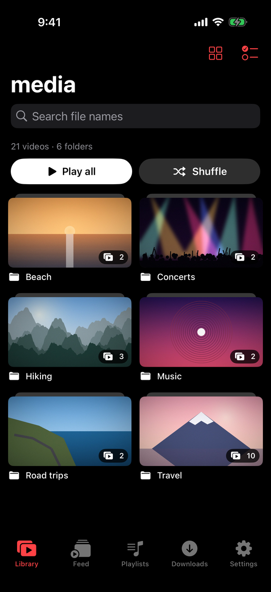
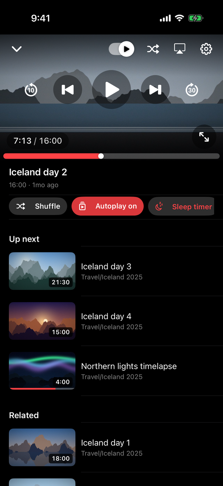
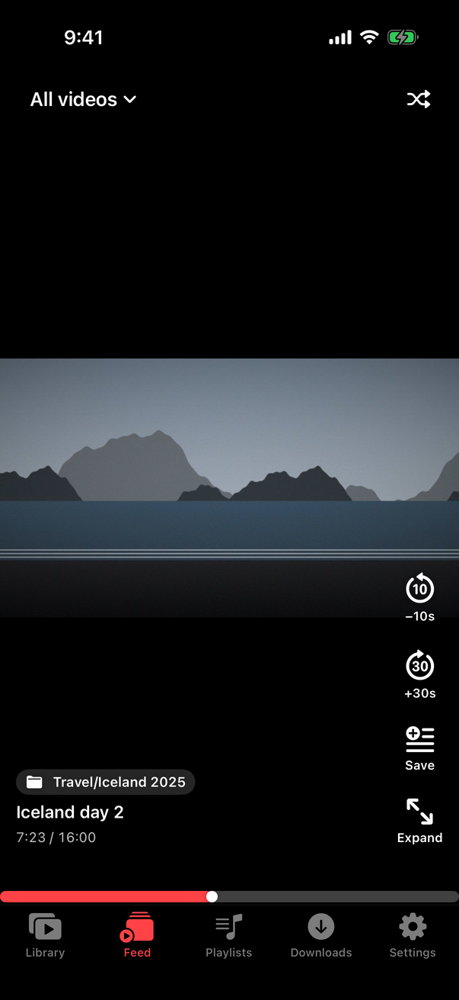
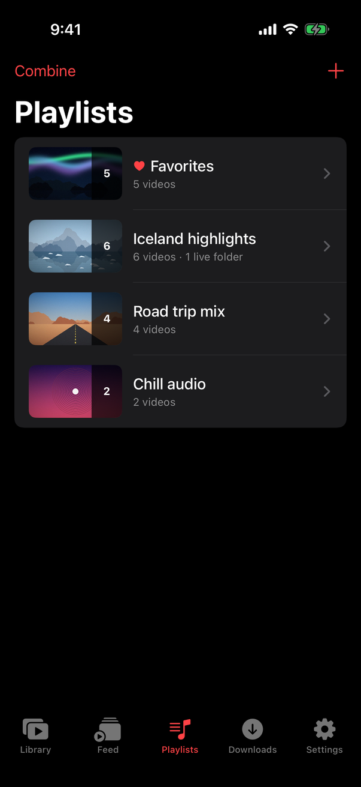

# R2be

An iPhone app that streams video and audio from a Cloudflare R2 bucket. You browse the bucket like a file manager and watch like YouTube. Everything plays inside the app.

<p align="center">
  
  
  
  
</p>

R2be is read-only. It lists and streams your files and never changes the bucket. Playlists, watch progress and thumbnails stay on the phone.

## Features

| Feature | What it does |
|---|---|
| **Library** | Browse folders as a list, a small or large grid, or feed cards. Sort by name, date, size or random order. |
| **Search** | Match file names in the current folder or the whole bucket. Case, accents, `_`, `-` and `.` are ignored. |
| **Player** | Skip back 10 s and forward 30 s with buttons or a double tap (change both in Settings). Speed 0.5–2×, AirPlay, sleep timer and landscape fullscreen. Swipe down to minimise, or sideways to change video. |
| **Up next** | Tap a video and the ones after it in that folder or playlist play next, in order. **Shuffle** plays them in random order instead. |
| **Related** | Shown under the player, 7 at a time. Suggests the rest of a series (`Trip day1`, `Trip day 2`…), similar names, a recent upload and videos with similar thumbnails. With **Loop queue** off, autoplay continues into Related when the queue ends. |
| **Picture in Picture** | A floating mini player while you browse, and system PiP when you leave the app. Lock screen controls work. |
| **Playlists** | Stored on the phone, with a built-in Favorites list. Add videos in bulk, then reorder, rename, duplicate or combine playlists. |
| **Feed** | Swipe through videos full screen, Shorts style, from all videos, recent uploads, a folder or a playlist. |
| **Downloads** | Save videos for offline play. They download in the background and stay out of iCloud backup. |
| **Thumbnails** | Grabbed from each video. A `clip.jpg`, `clip.mp4.jpg` or `thumbs/clip.jpg` next to `clip.mp4` replaces the grabbed frame. Long-press a folder to give it a cover photo. |
| **Resume** | Each video picks up where you stopped, and a red bar on its thumbnail shows how far you got. |
| **Several buckets** | Add more under **Settings → Buckets**. Playlists can mix videos from any of them. |

### Formats

| Plays | Hidden |
|---|---|
| MP4, MOV, M4V, 3GP (H.264 or HEVC) | MKV, AVI, WebM (iOS can't play them) |
| MP3, M4A, FLAC, WAV | HLS `.m3u8` (its segment links can't be signed) |
| | Everything else (documents, archives, images) |

Convert MKV to MP4 without re-encoding. The `+faststart` flag also speeds up seeking and thumbnails.

```bash
ffmpeg -i in.mkv -c copy -movflags +faststart out.mp4
```

To index only some folders, open **Settings → Edit connection → Folders to index**.

## Setup

### 1. Create a read-only R2 token

1. In the Cloudflare dashboard, open **R2 → Manage R2 API Tokens → Create API token**.
2. Set Permissions to **Object Read only**. Scope it to your bucket, or to all buckets if you want the app to list them.
3. Copy the **Access Key ID**, **Secret Access Key** and **Account ID**. The Account ID is the first part of the endpoint `https://<ACCOUNT_ID>.r2.cloudflarestorage.com`.

R2 needs no CORS setup, because the app signs its own S3 requests.

### 2. Build the app on GitHub (no Mac needed)

1. Push this folder to a **private** GitHub repo. Run this in PowerShell from the folder.

   ```powershell
   git init; git add .; git commit -m "R2be"
   git branch -M main
   git remote add origin https://github.com/<you>/r2be.git
   git push -u origin main
   ```

2. The push starts **Build unsigned IPA**, which takes about 5–8 minutes. You can also start it from **Actions → Build unsigned IPA → Run workflow**.
3. Open the finished run, download the **R2be-ipa** artifact and unzip it to get `R2be.ipa`.

### 3. Install with Sideloadly (free Apple ID)

1. Install **iTunes** and **iCloud** from apple.com. The Microsoft Store versions don't work with Sideloadly.
2. Install **Sideloadly** from sideloadly.io. Plug in the iPhone and tap **Trust**.
3. Drag `R2be.ipa` into Sideloadly, enter your Apple ID and click **Start**.
4. Trust the app on the iPhone.
   - Turn on **Settings → Privacy & Security → Developer Mode**, then restart.
   - Open **Settings → General → VPN & Device Management**, choose your Apple ID and tap **Trust**.
5. Open R2be, enter the Account ID, Access Key ID and Secret, tap **Test connection**, then **Save**.

A free Apple ID has two limits.

- The app expires after **7 days**. Run Sideloadly again, or turn on its Wi-Fi auto-refresh. Your data is kept.
- You can sideload at most **3 apps** at a time.

### 4. TestFlight (optional, paid developer account)

With a paid Apple Developer account, the **TestFlight** workflow signs each build in Apple's cloud and uploads it. You then install and update R2be from the TestFlight app. You don't need Sideloadly or Developer Mode, and each build lasts 90 days.

The workflow skips itself until its secrets exist. Set it up once, in a browser:

1. **Register a bundle ID.** At [developer.apple.com/account](https://developer.apple.com/account), open **Identifiers → + → App IDs → App**. Enter `R2be` and an explicit bundle ID such as `com.yourname.r2be`.
2. **Create the app.** In [App Store Connect](https://appstoreconnect.apple.com), open **Apps → + → New App**. Choose iOS and the bundle ID from step 1. The name must be unique on the App Store (for example `R2be Player`), but the home-screen name stays R2be.
3. **Create an API key.** Open **Users and Access → Integrations → App Store Connect API → Team Keys** and click **+**. Set Access to **Admin**, which cloud signing requires. Download the `.p8` file (Apple allows this only once). Note the **Key ID** and the **Issuer ID**.
4. **Find your Team ID** under **Membership details** at developer.apple.com/account.
5. **Add repository secrets** under **Settings → Secrets and variables → Actions**.

   | Secret | Value |
   |---|---|
   | `APPLE_TEAM_ID` | Team ID (step 4) |
   | `APP_BUNDLE_ID` | Bundle ID (step 1) |
   | `ASC_KEY_ID` | Key ID (step 3) |
   | `ASC_ISSUER_ID` | Issuer ID (step 3) |
   | `ASC_KEY_P8` | The whole `.p8` file, including the `BEGIN` and `END` lines |

6. **Run it** from **Actions → TestFlight → Run workflow**. Apple then takes 5–30 minutes to process the build.
7. **Add yourself as a tester.** In App Store Connect, open your app's **TestFlight → Internal Testing → +**. Create a group, turn on automatic distribution and add yourself.
8. **Install** the TestFlight app on the iPhone and sign in with the same Apple ID. R2be appears there, and later builds arrive as updates.

If a run fails, download its **testflight-log** artifact. Each run uploads a new build number, so start a new run instead of re-running an old one.

## GitHub Actions minutes

macOS minutes count 10× against your plan, so the workflows run only when needed:

- A push builds only if it changes `R2be/`, `project.yml` or the workflow file. README edits build nothing.
- A newer push cancels a build that's still running.
- `[skip ci]` in a commit message skips the build for that push.
- Several commits pushed together build once.
- Unit tests run only by hand, from **Actions → Tests → Run workflow**.

## How it works

- The app lists the whole bucket (1,000 keys per request) and caches the list on the phone. It refreshes on launch, at most every 15 minutes, and when you pull to refresh. Browsing, search and playlists then run on the phone without R2 requests.
- Videos stream through signed links, valid for 6 hours by default (change in Settings). R2 serves byte ranges, so seeking downloads only what you watch.
- Parts you've already watched play from a cache on the phone, so rewinding is instant (**Instant rewind** in Settings).

## Project layout

```
project.yml                  XcodeGen spec; the workflows turn it into R2be.xcodeproj
.github/workflows/
  build-ipa.yml              unsigned .ipa for Sideloadly
  testflight.yml             signed build uploaded to TestFlight
  tests.yml                  unit tests on a simulator (manual)
R2be/
  App/                       app entry and tab bar
  R2/                        request signing, R2 client, XML parsing, Keychain
  Models/                    videos, playlists, sorting, search
  Services/                  library index, player, playlists, thumbnails, downloads,
                             rewind cache, watch progress, Picture in Picture
  Views/                     library, player, feed, playlists, downloads, settings
R2beTests/                   unit tests
screenshots/                 README images; make_demo.py builds the fake library they show
```
